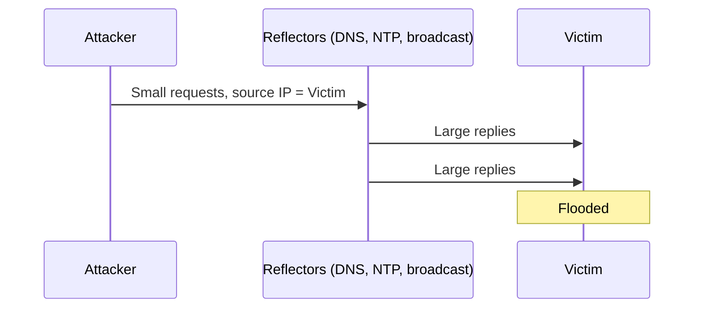
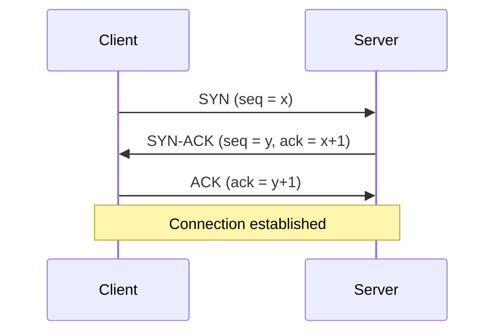

This afternoon I went through the IPv4 and IPv6 headers. Tonight is about what attackers do with them. IP, ICMP, TCP and UDP were built when the internet was a small, trusted network. Source addresses aren't verified and many messages are accepted without question, and attackers still take advantage of that.

## IP vulnerabilities at a glance

| Attack | In simple words |
|---|---|
| **ICMP attacks** | Abusing ICMP messages to scan, map, redirect or flood |
| **DoS** | One source overwhelms a target so real users can't reach it |
| **DDoS** | Many sources (usually a botnet) do it together |
| **Address spoofing** | Faking the source IP or MAC address |
| **Man-in-the-middle** | Sitting secretly between two devices |
| **Session hijacking** | Taking over a connection someone else already logged in to |

## ICMP attacks

**ICMP** carries error and status messages. `ping` uses it: it sends an **echo request**, and a live host sends back an **echo reply**. Devices answer ICMP automatically, which is useful for troubleshooting and also for attackers:

- **Echo request / echo reply:** a **ping sweep** pings a whole range (like `192.168.1.1–254`) to find live hosts. A **ping flood** overwhelms a target.
- **Unreachable:** "destination unreachable" replies reveal which networks, hosts and ports exist during scans.
- **Mask reply:** reveals a network's subnet mask, which helps map it.
- **Redirects:** normally a router saying "use a better route." A fake redirect makes a victim send traffic through the attacker (MitM).
- **Router discovery:** fake router announcements inject bogus routes into a host's routing table.

Networks usually **filter** ICMP at the edge: they keep the messages needed for normal operation and block things like redirects and mask replies from outside. Blocking *all* ICMP can break normal networking.

## DoS and DDoS

A **DoS** attack makes a service unavailable, either with too much traffic or with malformed packets that crash it. It attacks **availability**.

A **DDoS** does the same from thousands of machines at once, usually a **botnet** of infected devices (**zombies**) controlled through a **command and control (C2)** server. In 2016, the **Mirai** botnet, built from IoT cameras and routers with default passwords, took down major websites by attacking the DNS provider Dyn.

DoS from one source is easy to block. DDoS traffic comes from everywhere and looks like real users, so it's much harder.

## Amplification, reflection and spoofing

These three are usually combined:

1. **Spoofing:** the attacker puts the **victim's IP** as the source address
2. **Reflection:** they send requests to third-party servers, which reply to the victim
3. **Amplification:** they pick requests where the reply is much **bigger** than the request

The classic example is the **Smurf attack**: a ping sent to a network's **broadcast address** with the victim's IP as the source. Every device on that network replies to the victim, so one packet becomes hundreds. Today, attackers use UDP services with big replies, like open **DNS**, **NTP** and **Memcached** servers.

Defenses: **ingress filtering** by internet providers (dropping packets with source addresses that can't be right), closing open resolvers, rate limiting, and DDoS protection services.

## Address spoofing

- **IP spoofing:** faking the source IP to hide, bypass IP-based rules or reflect attacks
- **MAC spoofing:** copying another device's MAC address on the local network

| | Non-blind spoofing | Blind spoofing |
|---|---|---|
| **Sees the replies?** | Yes (same network) | No |
| **Typical use** | Session hijacking | DoS, where replies don't matter |

Defenses: firewalls should drop internet traffic claiming a **private** source (`10.x`, `172.16–31.x`, `192.168.x`) or the company's own addresses; routers can use **uRPF** to drop packets arriving from an unexpected direction; switches use port security against MAC spoofing.

## Man-in-the-middle and session hijacking

At the IP level, attackers get into the middle with ICMP redirects, ARP spoofing, rogue DHCP servers or fake Wi-Fi. Once there, they can try **session hijacking**: taking over a session that's already authenticated, so no password is needed. It can happen at the network level (TCP, below) or the application level (stealing a session cookie). Encryption (HTTPS, VPN) is the main defense.

## How TCP works

**TCP** gives reliable connections for the web, email, SSH and file transfer. It provides:

- **Reliable delivery:** every segment is acknowledged (ACK), and missing data is resent
- **Ordered delivery:** **sequence numbers** let the receiver put data back in order
- **Flow control:** the receiver's **window size** says how much it can accept
- **Stateful communication:** both sides track the connection

Before data flows, TCP does the **three-way handshake**:

1. **SYN:** "I want to connect"
2. **SYN-ACK:** "OK, I'm ready"
3. **ACK:** "Let's start"

After step 2, the server holds a **half-open connection** in memory while it waits for the final ACK. Connections normally close with FIN messages, or abruptly with **RST** (reset).

## TCP attacks

- **SYN flood:** the attacker sends huge numbers of SYNs, usually from spoofed addresses. The server replies and waits for ACKs that never come, and its table of half-open connections fills up until real users are refused. *Defense:* **SYN cookies** (the server doesn't reserve memory until a valid ACK returns), shorter timeouts, and firewalls that handle handshakes.
- **TCP reset attack:** a forged RST packet with the right addresses, ports and an acceptable sequence number makes one side drop a real connection immediately.
- **TCP session hijacking:** the attacker spoofs one side and guesses the next **sequence number** to inject data into an existing session. Modern systems use random starting sequence numbers, which makes blind guessing almost impossible, but it's much easier when the attacker can see the traffic. Encryption stops injected data from being accepted.

## How UDP works

**UDP** is the lightweight option: no handshake, no acknowledgments, no retransmission. It's used where speed matters, like DNS, DHCP, NTP, VoIP, streaming and games.

Its header is only **8 bytes**: source port, destination port, length and checksum.

| | TCP | UDP |
|---|---|---|
| Connection | Handshake first | None |
| Reliability | ACKs and resends | None |
| Header | 20–60 bytes | 8 bytes |
| Examples | HTTPS, SSH, email | DNS, DHCP, VoIP |
| Easy to spoof? | Harder | **Easy** |

## UDP attacks

- **Checksum tampering:** the UDP checksum isn't protected. An attacker who intercepts a packet can change the data and recalculate the checksum, and the receiver won't notice.
- **UDP flood:** packets sent to random ports. For each one, the target checks for a listening app, finds none and replies with ICMP "port unreachable," wasting resources and bandwidth. The course mentions tools like **UDP Unicorn** and **Low Orbit Ion Cannon (LOIC)**.
- **UDP amplification:** since there's no handshake, UDP is ideal for spoofed reflection attacks via DNS, NTP and Memcached.

## Why this matters for a SOC engineer

- **Ping sweeps and port scans** are early warning signs: one IP touching many hosts or ports in a short time.
- **SYN floods** show up as a spike in half-open connections and SYNs with no matching ACKs.
- **Amplification attacks** look like a flood of DNS or NTP *responses* nobody asked for.
- **Spoofed traffic:** internet packets with private source addresses should be blocked and investigated.
- **Wireshark filters** I want to remember: `tcp.flags.syn == 1 && tcp.flags.ack == 0` shows SYN-only packets, and `icmp.type == 5` shows ICMP redirects.

## Questions I should be able to answer

- Which ICMP messages can attackers abuse, and how?
- DoS vs DDoS?
- How does a Smurf attack combine spoofing, reflection and amplification?
- Walk through the TCP three-way handshake.
- How does a SYN flood work, and how do SYN cookies help?
- Why is UDP easier to spoof than TCP?

## Next

Tomorrow: attacks on network services like ARP, DNS, DHCP, HTTP and email, and then how to defend the network.
