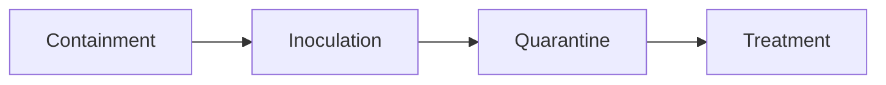

After a week of learning how attacks work, the second half of today was finally about **defense**. This is the post I'll come back to most, because these tools (firewalls, IDS/IPS, ACLs, syslog, NetFlow, AAA) are what a SOC works with every day. It's a big section, so I've kept each part focused.

## Mitigating malware and worms

For **malware** in general: endpoint protection (ideally behavior-based EDR), fast patching, email and web filtering, least privilege, offline backups and user training.

**Worms** spread by themselves, very fast, so the response follows four steps **in order**:



1. **Containment:** stop the spread. Segment the network and use ACLs to block the worm's traffic between segments. This comes first because nothing else works while it's spreading.
2. **Inoculation:** patch all systems that **aren't infected yet**, like vaccinating healthy people during an outbreak.
3. **Quarantine:** find every infected machine and isolate it.
4. **Treatment:** clean infected machines, or wipe and rebuild them if cleaning isn't reliable, then patch before reconnecting.

## Mitigating other attacks

- **Reconnaissance** (scans, sniffing): encryption, strong authentication, anti-sniffer tools, switched networks, and firewalls/IPS that block scans. It can't be fully prevented, so the goal is to make it harder and **detect** it.
- **Access attacks** (password guessing, exploits): strong passwords, MFA, **account lockout** after failed attempts, least privilege and encryption.
- **DoS attacks:** know your normal traffic so spikes stand out, plus IPS, anti-spoofing, rate limiting and DDoS protection services.

## How wireless works

You can't secure what you don't understand, so the course explains Wi-Fi first.

- **WLANs** follow the **IEEE 802.11** standards. Clients connect to an **access point (AP)**. The network name is the **SSID**.
- **Frame structure:** an 802.11 frame has Frame Control, Duration, up to **four addresses** (because frames often go client → AP → wired network), Sequence Control, the Payload and an **FCS** for error checking. There are management frames (beacons, probes), control frames and data frames.

| | Wireless LAN | Wired Ethernet LAN |
|---|---|---|
| Medium | Radio waves | Cables |
| Physical boundary | **None**, signals leave the building | Where the cables go |
| Access method | CSMA/CA | CSMA/CD (old shared Ethernet) |
| Interference | Microwaves, walls, other networks | Very little |
| Security | Anyone nearby can listen, so **encryption is essential** | Attacker needs physical access |

- **CSMA/CA:** devices share one channel and can't detect collisions while sending, so they **avoid** them: listen → wait if busy → wait a random extra moment → send → wait for an ACK → retry if none arrives.
- **Discovery:** in **passive mode**, APs broadcast **beacons** with the SSID and security settings, and clients listen. In **active mode**, clients send **probe requests** ("Is Office_WiFi here?") and APs answer. Phones probing for remembered networks is exactly what helps attackers build evil twins.
- **WLAN threats:** interception, intruders, rogue APs and DoS. Wireless DoS can come from **misconfiguration**, a **malicious user jamming**, or **accidental interference** (like microwaves on 2.4 GHz).

## Securing WLANs

**Two weak methods:** **SSID cloaking** (the name still appears when clients connect) and **MAC filtering** (MAC addresses are sent in the clear and can be copied). They don't hurt, but they aren't real security.

**Original 802.11 authentication:**
- **Open:** no password, used in cafés and airports
- **Shared key:** one key for everyone, used by **WEP** (broken), **WPA**, **WPA2** and **WPA3**

**Home users (Personal mode):** one **pre-shared key (PSK)** for everyone. A **four-way handshake** proves both sides know it and creates session keys. The downside: with WPA2, a captured handshake can be attacked offline to guess weak passwords.

**Encryption:** **TKIP** (WPA, now deprecated) vs **AES** (WPA2/WPA3, the one to use). If a router offers "TKIP/AES," choose **AES only**.

**Enterprise:** each user logs in with their own account, checked by a **RADIUS** server using **802.1X**. There are three roles: the **supplicant** (client), the **authenticator** (the AP, which just passes messages) and the **authentication server** (RADIUS, which decides). The AP needs the RADIUS server's IP, the UDP ports (**1812** authentication, **1813** accounting) and a shared key. When someone leaves, you disable only their account.

**WPA3** brings four improvements:
- **WPA3-Personal:** uses **SAE** instead of PSK, which blocks offline password guessing
- **WPA3-Enterprise:** an optional stronger 192-bit mode
- **Open networks:** **OWE** encrypts café Wi-Fi traffic even without a password
- **IoT onboarding:** **DPP** adds screenless devices securely, usually by scanning a QR code

## Firewalls

A **firewall** enforces an access policy between networks: it compares traffic to rules, top to bottom, and the first match decides. Anything unmatched is denied by default.

- **Common properties:** it resists attacks itself, it's the **only** path between networks, and it enforces the access policy.
- **Benefits:** hides sensitive hosts from untrusted users, cleans up protocol flows, blocks malicious data, and centralizes security management.
- **Limitations:** a misconfiguration can be serious (and the firewall can become a single point of failure), some applications can't pass through easily, users may work around it, it can slow the network, and traffic can be **tunneled** through allowed protocols.

### Security architectures

- **Private and public:** inside → outside is allowed; outside → inside is blocked except for replies to inside traffic.
- **DMZ (demilitarized zone):** a separate zone for public servers (web, email, DNS). The internet can reach only specific services there, and the DMZ can't reach the inside network. If a web server is hacked, the attacker is still kept away from the internal network.
- **Zone-based policy firewall (ZPF):** interfaces are grouped into zones (inside, outside, DMZ, guest), and traffic between zones is blocked unless a policy allows it. It's easier to manage as networks grow.

### Firewall types

| Type | How it works | Trade-off |
|---|---|---|
| **Packet filtering (stateless)** | Checks each packet alone by IP, port and protocol (Layers 3–4), often with router ACLs | Fast and simple, but has no memory of connections |
| **Stateful** | Tracks connections in a **state table** and allows only packets belonging to them | The most common type, much safer |
| **Application gateway (proxy)** | Sits in the middle and inspects up to Layer 7 | Deep inspection, but slower |
| **Next-generation (NGFW)** | Stateful + app awareness + built-in IPS + URL filtering + malware protection | Most complete, more complex |

A quick example of why state matters: when I browse a site, the reply comes back to a random high port on my laptop. A stateless firewall needs a rule allowing incoming traffic to a whole range of high ports, which leaves a big hole. A stateful firewall remembers my request and allows only that one reply.

## IDS and IPS

| | IDS | IPS |
|---|---|---|
| **Placement** | Watches a **copy** of traffic (promiscuous mode) | Sits **inline**, in the traffic path |
| **Action** | Alerts only | Can block |
| **Pros** | No effect on network speed; if it fails, traffic keeps flowing | Stops the attack packets before they arrive |
| **Cons** | Can't stop the first packets; needs tuning; easier to evade | Adds latency and jitter; a failure or false alarm can block real traffic |

**Deployment considerations:** they can be used together, placement matters (edge, DMZ, in front of key servers), the device must handle the traffic volume, encrypted traffic can't be inspected without decryption, and tuning is needed to balance **false positives** (false alarms) against **false negatives** (missed attacks, the dangerous ones).

**Types of IPS:** **host-based (HIPS)** runs on one machine and sees what happens inside it, including decrypted traffic. **Network-based** sits on the network and protects a whole segment, but can't see inside encrypted traffic or tell whether an attack worked on the host.

**Specialized appliances** (Cisco has renamed them since):
- **AMP** (now Secure Endpoint): malware detection that keeps tracking files and shows where a bad file spread
- **WSA** (now Secure Web Appliance): a web proxy that filters URLs and blocks web threats
- **ESA** (now Secure Email): filters spam, phishing and malicious attachments

## Security services

### ACLs

An **access control list** is an ordered list of permit/deny rules based on source and destination IP, protocol and ports. Rules are checked top to bottom, the **first match wins**, and every ACL ends with an invisible **deny all**.

```
access-list 110 permit tcp 192.168.10.0 0.0.0.255 any eq 443
access-list 110 permit udp 192.168.10.0 0.0.0.255 any eq 53
access-list 110 deny ip any any log
interface GigabitEthernet0/0
 ip access-group 110 in
```

This allows the `192.168.10.0/24` network out to HTTPS (443) and DNS (53), and blocks and **logs** everything else. `0.0.0.255` is a **wildcard mask**: 0 means "must match," 255 means "anything." **Standard** ACLs filter only on source IP; **extended** ones, like this example, also use destination, protocol and ports.

Useful ACL features: the `established` keyword (lets return TCP traffic in but blocks new outside connections), reflexive and time-based ACLs, and the `log` keyword for monitoring. Order matters: putting `deny ip any any` first would block everything.

### Monitoring services

- **SNMP:** a central manager monitors devices through agents on each device (UDP 161, with traps on 162). v1/v2c send **community strings** in plain text; **SNMPv3** adds authentication and encryption and is the only version to use.
- **NetFlow:** records **flows**: who talked to whom, on which ports, when and how much, but not the content. It's like a phone bill, not a recording. It's great for spotting data exfiltration and scanning.
- **Port mirroring (SPAN):** the switch copies traffic from one port to another, where an IDS or Wireshark can analyze it.
- **Syslog:** devices send logs to a central server (UDP 514), so copies survive even if an attacker wipes a device. Severity runs from **0 (Emergency)** to **7 (Debug)**: Emergency, Alert, Critical, Error, Warning, Notification, Informational, Debugging. Setting level 4 sends levels 0–4.
- **NTP:** keeps all device clocks in sync (UDP 123). Without matching timestamps, you can't put events from different devices in order during an investigation.

### AAA, TACACS+ and RADIUS

**AAA** = **Authentication** (who are you?), **Authorization** (what can you do?), **Accounting** (what did you do?). Think of a bank card: the PIN proves it's you, your limit controls what you can withdraw, and the statement records it all. A central AAA server means you don't need separate accounts on hundreds of devices.

| | TACACS+ | RADIUS |
|---|---|---|
| Transport | TCP 49 | UDP 1812/1813 |
| Encryption | Whole packet body | Password only |
| AAA | Keeps the three separate | Combines authentication and authorization |
| Per-command authorization | Yes | No |
| Main use | Admins logging in to network devices | Users joining Wi-Fi (802.1X) and VPNs |
| Origin | Cisco | Open standard |

### VPN

A **VPN** builds an encrypted tunnel across a public network. **Site-to-site** VPNs connect whole offices; **remote-access** VPNs connect individual users. **IPsec** is common for site-to-site, and SSL/TLS VPNs are common for remote users. And as I noted in Part 1, only company-approved VPNs should be allowed.

## Why this matters for a SOC engineer

This whole post is basically the SOC toolbox:
- **Syslog, NetFlow, firewall and IDS/IPS logs** are what a SIEM collects. Getting them in reliably and parsing them is core SOC engineering work.
- **NTP** sounds boring until wrong timestamps ruin an investigation.
- **Tuning IDS/IPS** to cut false positives without missing real attacks is an engineer's job.
- **SPAN ports** feed network sensors like an IDS.
- **AAA accounting logs** show exactly who changed what on network devices.
- The **worm response steps** are a mini incident response plan.

## Questions I should be able to answer

- What are the four worm mitigation steps, in order?
- Why do wireless networks use CSMA/CA instead of CSMA/CD?
- Why are SSID cloaking and MAC filtering weak?
- What does SAE in WPA3 fix?
- Stateless vs stateful firewall? What is a DMZ for?
- IDS vs IPS: one advantage and one disadvantage of each?
- What does NetFlow record, and what doesn't it record?
- TACACS+ vs RADIUS: three differences?

## Next

I still have a few sections of the Endpoint Security course left, and I plan to cover them tomorrow. After that, I'll move on to Cisco's **Network Defense** course, which goes deeper into many of the defenses I touched on today.
